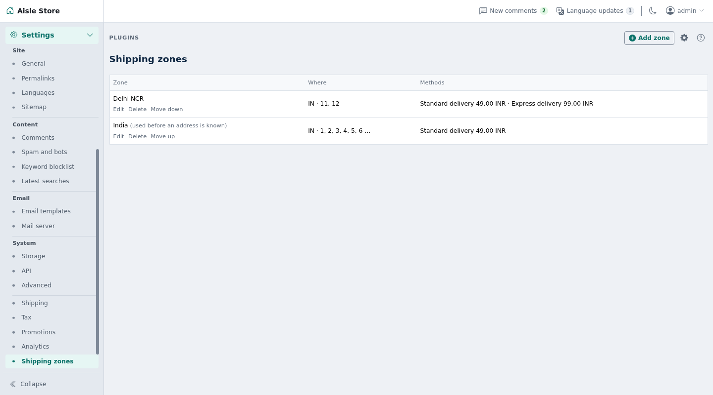
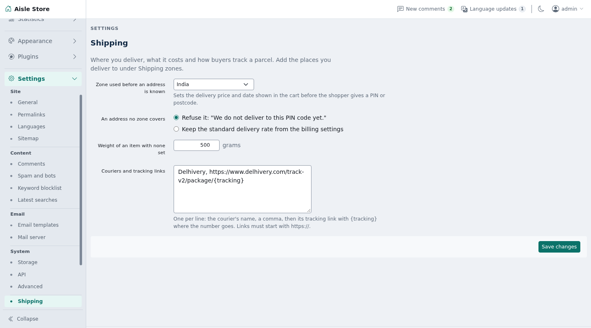

# Shipping

Delivery zones for Shopclass shop orders: flat and weight-based prices, shipping class charges, Standard and Express delivery, free delivery over an amount, delivery dates, postcode checks and courier tracking links.




## Requirements

- Shopclass 7.1.0 or later, in shop mode
- PHP 8.2 or later
- No outside accounts. No cron, worker, Redis or shell needed.

## Install

1. Open **Plugins → Browse** (or upload the zip from the GitHub release).
2. Install.
3. Activate.

## Set up

1. Open **Billing → Shipping** and press **Add zone**.
2. Fill **Name**, then **Countries**, **States** and **Postcode starts** for where it covers. Leave a list empty to cover everything.
   Under **Shipping class charges**, write one class per line with its extra charge, such as `bulky = 200`.
3. For **Standard delivery** and **Express delivery**, turn on **Offer this method in the zone** and set **Name at checkout**, **Price**, the weight included, the price per extra kilo, the free-over amount and the delivery days.
4. Press **Save zone**. Use **Move up** and **Move down** to order zones.
5. Open the **Settings** tab on the same screen:
   - **Zone used before an address is known**
   - **An address no zone covers**
   - **Weight of an item with none set** (grams)
   - **Couriers and tracking links**

Amounts are in the site's currency.

## How it works

- The most exact zone wins: a postcode start beats a state, a state beats a country. Among zones of the same kind, the one higher in the list wins.
- A zone with states needs the shopper's state. A zone with postcode starts needs a postcode. `11` covers every postcode starting `11`. States ignore capitals and spaces.
- A zone with every method off never matches.
- Before the shopper gives an address, the default zone prices the cart. With no default zone, core's flat rate shows.
- Price: `amount + per_kg × (started kilos above the included weight)`. Every started kilo counts, so 1,001 g over is two kilos.
- Delivery is free once the items reach the free-over amount. Empty means never. That amount also drives the cart's free-delivery meter.
- An item with no weight counts as the default weight.
- Shipping classes come from each product variant's **Shipping class**. A class with a charge in the zone adds that charge for each item, on top of the price. Free-over still makes the whole delivery free.
- Items in the class `free` ship free and add no weight. A cart of only `free` items ships free.
- A method with fastest and slowest day counts shows a date range, such as "20 Oct - 21 Oct". One day exactly shows "Tomorrow". Both at 0 shows no date. The estimate is kept on the order's shipping line.
- For an address no zone covers, **Refuse it** (default) says "We do not deliver to this address yet." **Keep the standard delivery rate** keeps core's flat rate.
- Tracking: under **Couriers and tracking links**, write one per line, a name, a comma and an https link with `{tracking}`:

  ```
  My Courier, https://example.com/track/{tracking}
  ```

  When an admin ships an order with a matching courier name and a tracking number, the buyer gets that link. Links that are not https, or lack `{tracking}`, are refused.

## Notes / limits

- With no zones at all, nothing is refused.
- An address missing the postcode or state a zone needs is not refused. The default zone prices the cart until the shopper types it.
- No database query when a cart is priced. Zones are read from the settings core already loads.
- Without the cart hooks (older Shopclass), the plugin loads, does nothing and says so in the admin.
- Zones and settings are preferences in the `shipping` section. No table of its own.
- Uninstalling removes the zones and settings. Orders keep what they were charged.

## For developers

Listens to the filters `cart_shipping_methods`, `cart_problems`, `cart_free_over` and `billing_tracking_url`. It fires no hooks.

Translations: copy `languages/shipping.pot` to `languages/<locale>/messages.po`, translate, and compile to `messages.mo`. Rebuild the template with `php tools/make-pot.php`.

Tests: `./tests/run.sh` (unit) and `php tests/integration/quote.php` (needs core's scratch MySQL on port 33061).

## Support

[GitHub issues](https://github.com/mindstellar/shopclass-plugin-shipping/issues)

## License

GPL-3.0-or-later. See [LICENSE](LICENSE).
